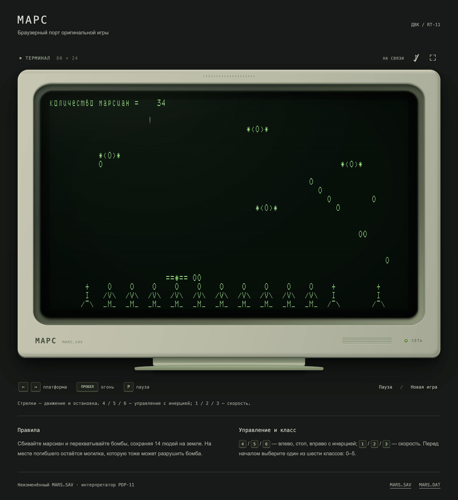

# МАРС

Браузерный порт игры «Марс» для ДВК и RT‑11. Интерпретатор PDP‑11 выполняет неизменённый `MARS.SAV`: правила, символьная графика, столкновения и очки определяются оригинальным машинным кодом.

**[Открыть игру](МАРС.html)** · **[MARS.SAV](MARS.SAV)** · **[MARS.DAT](MARS.DAT)**

Готовый `МАРС.html` можно открыть двойным щелчком — он работает без интернета и установки.



## Оригинальная игра

«Марс» — символьная аркада: игрок управляет платформой, стреляет вверх по марсианам и защищает людей от падающих бомб. В сохранённой версии 14 людей и шесть классов, от 0 до 5. На месте погибшего человека появляется могилка; следующее попадание может уничтожить и её.

Игра существовала в 1980-х: «Марс» для ДВК упоминается в книге [«Компьютерные игры» (издательство «Знание», 1988)](https://ru.djvu.online/file/OqY0VCUnFdx93). В [архиве программ ДВК и УКНЦ](https://archive.pdp-11.org.ru/ukdwk_archive/) сохранились разные варианты `MARS.SAV`, в том числе с файловыми датами 1984 года. Эти даты не устанавливают год создания игры или дату нашей редакции. **Автор и точный год создания пока не установлены.**

Оригинальные файлы в этом репозитории сохранены без изменений: [MARS.SAV](MARS.SAV) — исполняемая программа, [MARS.DAT](MARS.DAT) — исходная таблица результатов. При игре результаты записываются в локальную копию в браузере.

Источники и материалы:

- [Архив ДВК и УКНЦ](https://archive.pdp-11.org.ru/ukdwk_archive/) — образы дисков и каталоги с вариантами игры.
- [«ДВК-ностальгия» Дмитрия Алексеева](https://sannata.org/konkurs/netskater001.shtml) — воспоминания об игре, платформах и человечках.
- [Воспоминания игроков, собранные DataArt](https://habr.com/ru/companies/dataart/articles/492956/) — упоминание `MARS.SAV` и управления с клавиатуры.
- [Знакогенератор терминала 15ИЭ‑00‑013](docs/font-15ie.md) — происхождение шрифта, источники и контрольные суммы.

## Личное воспоминание

В 1989 году, ещё в СССР, я впервые увидел компьютер в институте, где работал мой отец. Запомнились зелёные символы, платформа над человечками и крестики на месте погибших. Это воспоминание привело меня к поиску «Марса» и созданию браузерного порта.

## Управление

- `←` / `→` — движение, `Пробел` — огонь, `P` / `Esc` — пауза.
- Оригинальные клавиши: `4` / `5` / `6` — влево, стоп, вправо с инерцией; `1` / `2` / `3` — скорость.
- На сенсорном экране доступны кнопки под монитором.

Терминал воспроизводит экран 80 × 24 и КОИ‑7. Корпус монитора, стрелки, сенсорные кнопки и пауза — браузерная оболочка. Темп задан в 50 игровых циклов в секунду; скорость и внешний вид не откалиброваны по конкретному историческому ДВК.

## Запуск из исходников

Нужен Node.js 18 или новее, зависимостей нет.

```sh
npm start          # http://127.0.0.1:8080
npm run build     # статический сайт dist/ и автономный МАРС.html
npm test          # оригинальная программа, шрифт и автономная сборка
```

Модульный `index.html` запускается через HTTP-сервер; автономный `МАРС.html` можно открыть напрямую.
